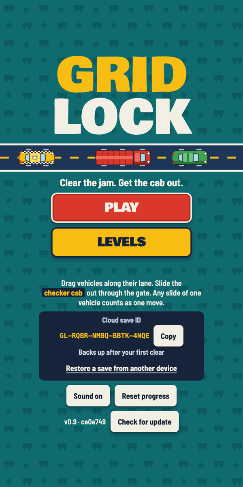
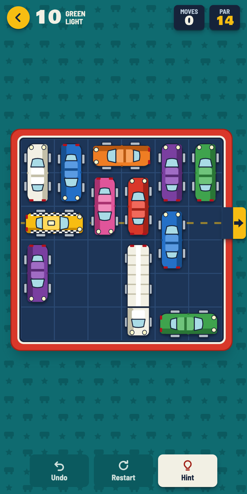
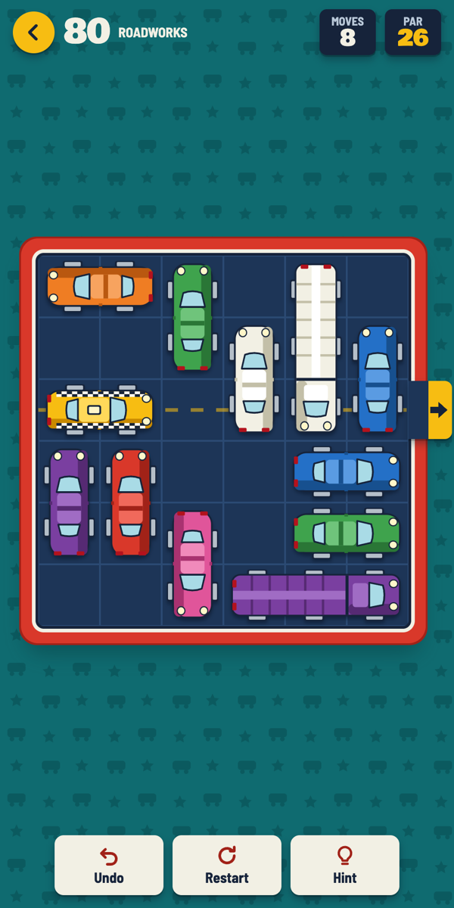

<p align="center">
  
</p>

<h1 align="center">Grid Lock</h1>

<p align="center">
  <strong>A tin-toy sliding-traffic puzzle that installs from the browser. 300 generated levels, each with an exact par.</strong>
</p>

<p align="center">
  <a href="https://grid-lock-zeta.vercel.app"><strong>▶ Play it now</strong></a> ·
  <a href="#deploy-your-own">Deploy your own</a> ·
  <a href="#run-it-locally">Run it locally</a>
</p>

<p align="center">
  <a href="https://vercel.com/new/clone?repository-url=https%3A%2F%2Fgithub.com%2FMRhino%2Fgrid-lock&project-name=grid-lock&stores=%5B%7B%22type%22%3A%22blob%22%7D%5D"></a>
</p>

<p align="center">
  
  
  
</p>

---

## At a glance

| | |
|---|---|
| **Genre** | Sliding-block traffic puzzle |
| **Platform** | Any modern phone or desktop browser. Installs as a PWA, works offline |
| **Stack** | TypeScript, plain DOM + CSS, Vite, `vite-plugin-pwa`, one Vercel Function for cloud save |
| **Size** | About 850 lines of TypeScript plus a JSON level pack. No game engine, no UI framework |
| **Hosting** | Vercel (static site + `api/save.ts`) |

## How it plays

- **Drag vehicles along their lanes.** Cars are two squares long, trucks three. Each only moves along its own axis.
- **Get the checker cab out** through the gate on the right of the third row.
- **One slide = one move**, however far it goes. Every level has a computed **par** (the true minimum), and you earn 1–3 stars depending on how close you get.
- **Undo, restart and hint** whenever you need them. Leave mid-level and it resumes exactly where you were.

### Levels

| Pack | Levels | Tiers |
|---|---|---|
| **Warm-Up** | 150 | A gentle on-ramp |
| **Campaign** | 150 | Green Light → Commuter → Roadworks → Standstill → Total Gridlock |

Par climbs steadily through the campaign, from 12 moves at the start up to 49 in Total Gridlock.

## How it's built

```
src/
  puzzle.ts    Pure puzzle logic: board parsing, moves, solver, par, stars, tiers. No DOM
  levels.json  The shipped level pack (append-only)
  main.ts      Screens, drag input, undo/hint, PWA update handling
  toys.ts      The printed-tin vehicle artwork (SVG, drawn in code)
  progress.ts  Local save with versioned migrations
  cloud.ts     Cloud backup client (sync on launch and after each clear)
  saveid.ts    Save IDs + level-by-level merge shared by client and server
  audio.ts     Synthesised sound effects (Web Audio, no files)
api/
  save.ts      Vercel Function: one private Blob per save ID
scripts/
  gen-levels.ts   Level generator
  test-puzzle.ts  Re-solves every shipped level, plus move and save tests
```

Things worth calling out:

- **Every level is generated and proven.** The generator samples random traffic, maps every position reachable from it, and keeps the hardest one. That gives each level an exact par, not an estimate.
- **No duplicate puzzles.** Two boards count as the same puzzle if their reachable positions match, even when a car is parked somewhere else, and `npm test` checks for it.
- **Difficulty is one number:** the target par for each level. No separate knobs.
- **Fair move counting.** Consecutive slides of the same vehicle merge into one move, so you're never penalised for dragging in two goes.
- **Progress survives every deploy.** The level pack is append-only, the save format is versioned with migrations, and the service worker never reloads mid-level.
- **A deliberate look.** A printed-tin wind-up toy city: saturated, flat, obvious. The full design system is in [`DESIGN.md`](DESIGN.md), and product intent in [`PRODUCT.md`](PRODUCT.md).

## Deploy your own

This repo is set up to go live on Vercel with no configuration.

1. Click **Deploy with Vercel** above. It forks the repo to your GitHub account, creates a Vercel project, and offers to create a **Blob store** for cloud saves.
2. Wait for the build (about a minute). Vercel detects Vite automatically: build command `npm run build`, output `dist/`.
3. Open your new URL on a phone and choose **Add to Home Screen** (Safari) or **Install app** (Chrome). It now runs fullscreen and offline like a native app.

Every push to `main` redeploys. Players get the new version automatically the next time they open the app outside a level.

**Doing it by hand instead:** fork the repo, import it at [vercel.com/new](https://vercel.com/new), then add a Blob store under **Storage → Create → Blob** and connect it to the project. That sets `BLOB_READ_WRITE_TOKEN` for you.

**Cloud save is optional.** Without a Blob store the game still works fully; progress is kept on the device, and only the cross-device backup is unavailable.

Preview deployments write saves under `preview/saves/`, so testing a branch never touches real player data.

## Run it locally

You need **Node.js 22.12 or newer**.

```bash
git clone https://github.com/MRhino/grid-lock.git
cd grid-lock
npm install
npm run dev        # http://localhost:5173, also exposed on your LAN to test on a phone
```

| Command | What it does |
|---|---|
| `npm run dev` | Dev server with hot reload |
| `npm run build` | Type-check and build into `dist/` |
| `npm run preview` | Serve the production build |
| `npm test` | Re-solve every level, plus move and save tests |
| `npm run levels -- 240` | Regenerate the campaign with a 240-second budget (only before it ships) |
| `npm run icons` | Regenerate the PNG app icons (drawn by a script, no image libraries) |

`dist/` is a plain static site, so it can be hosted anywhere. Cloud save needs the `api/` function, which is why Vercel is the recommended home. Installing to the home screen and offline play need HTTPS, so test those on a deployed build.

**Screenshot mode:** `?shot=LEVEL&solve=N` opens a level and plays N moves of the solution without saving.

## Make it your own

- **Name, colours, description:** the PWA manifest in [`vite.config.ts`](vite.config.ts) and the `<title>` in [`index.html`](index.html).
- **Look:** colour tokens and type in [`DESIGN.md`](DESIGN.md) and [`src/style.css`](src/style.css); vehicle paint in [`src/toys.ts`](src/toys.ts).
- **Levels:** your fork is new, so you can regenerate freely with `npm run levels`. Once real players have progress, only append.
- **Save key:** if you fork into a different game, change the `gl-` localStorage keys so saves don't collide on the same domain.

## Built with an AI pair programmer

Built in short loops with [Claude Code](https://claude.com/claude-code): play a build on a phone, give feedback, adjust. The working rules for that loop (version bump on every push, every level re-solved by tests, never lose progress) live in [`CLAUDE.md`](CLAUDE.md).

## More games

- [**Blaster Bricks**](https://github.com/MRhino/blaster-bricks): a neon ball-shooter with daily, weekly and monthly challenges
- [**Gate Runner**](https://github.com/MRhino/gate-runner): a 3D squad shooter in Three.js

## License

[MIT](LICENSE). Fork it, reskin it, ship it. The levels are generated, not copied from any commercial puzzle.
